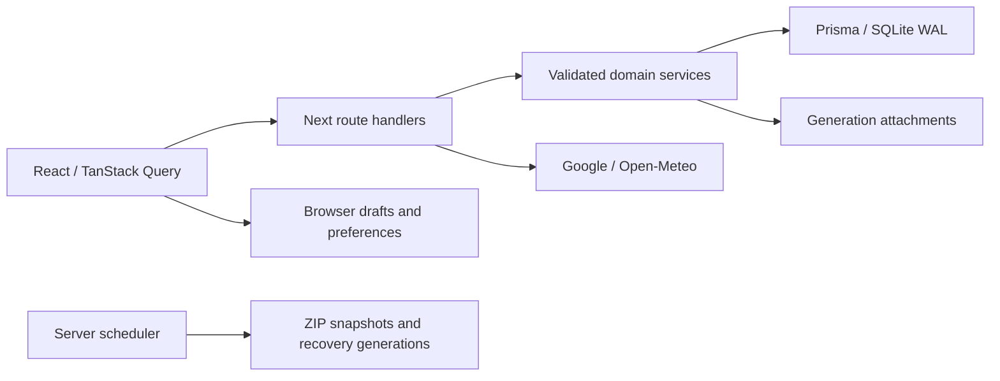

# Architecture

The single Node process owns a shared database and attachment directory. All users edit the same records. Domain schemas validate JSON payloads inside a typed entity envelope. This intentionally keeps the POC's many record types extensible while SQLite transactions, versions and server relation checks protect writes.

`src/lib` contains types and pure domain rules; `src/server` contains SQLite, mutation, provider and backup services; `src/components` contains shared presentations and feature workflows; `src/app/api` exposes HTTP interfaces. Prisma's generated client is a build artifact.

Writes serialize within the process and execute multi-record operations in transactions. Record versions reject stale writes with 409. Bulk/routine application operation IDs make retries idempotent. Run one container/process against a data directory, not multiple replicas.

Restore stages a separate data generation, then atomically changes `active.json`. Database and attachments always resolve through the same active generation. Prior data remains available for recovery.

The POC uses one global stylesheet for shared tokens and responsive components, with FullCalendar overrides isolated in `calendar.css`. Rich text is parsed by Tiptap rather than rendered as unchecked HTML. External Google results remain ephemeral; the application only persists user-authored places and explicit manual estimates.
